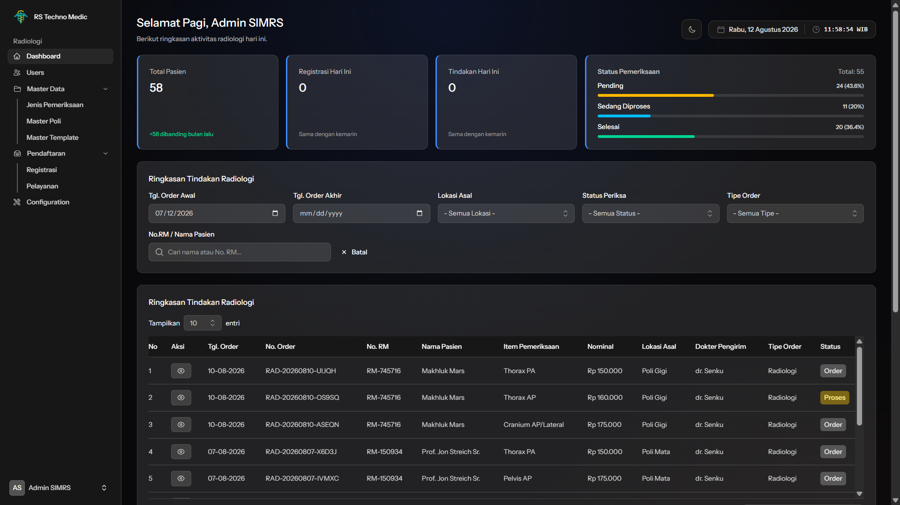
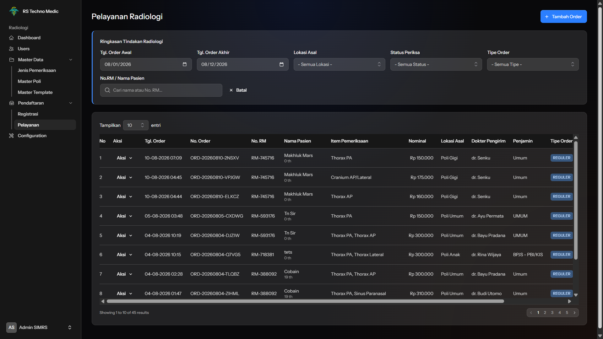
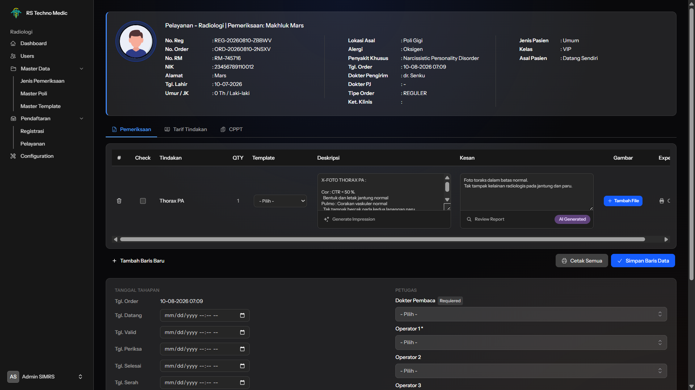
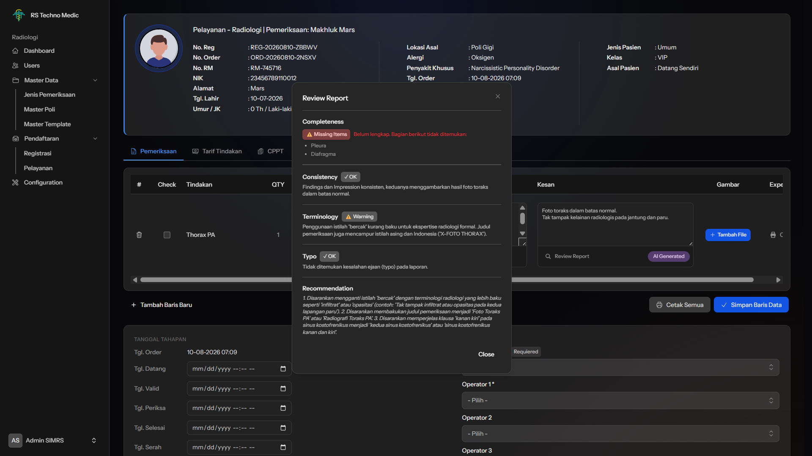
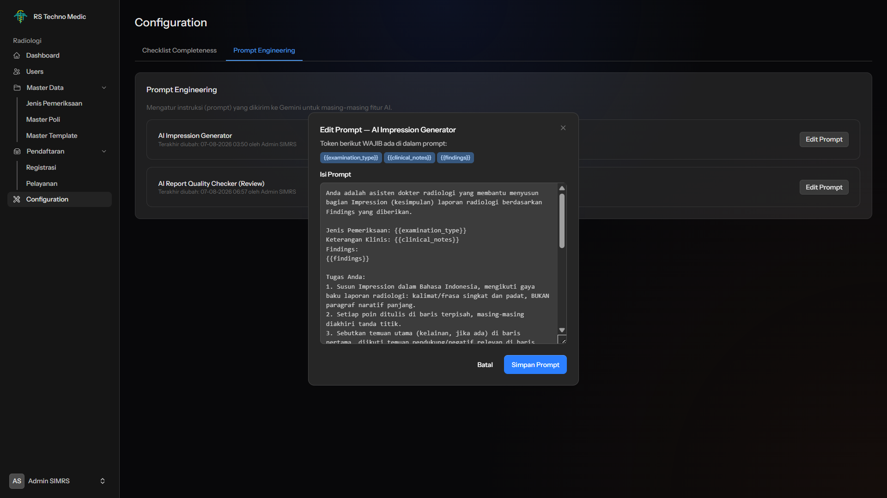

# AI-Assisted Radiology Reporting

Modul Radiologi berbasis web dengan kemampuan **AI-Assisted Reporting**, dikembangkan sebagai proyek Kerja Praktik (KP) yang mengacu pada workflow dan kebutuhan modul Radiologi **PT Indo Techno Medic**. Sistem ini mengintegrasikan **Google Gemini Flash API** untuk membantu dokter radiologi menyusun dan memvalidasi laporan radiologi, dengan prinsip **AI sebagai asisten, bukan pengganti dokter (Human-in-the-Loop)**.

> Prototype ini berdiri sendiri (standalone), tidak terintegrasi ke SIMRS existing. Struktur data dirancang mengikuti alur SIMRS nyata: Registrasi → Pelayanan → Tindakan → Detail Tindakan → Tindakan Hasil.

---

## 1. Overview

Proses pelaporan radiologi konvensional menghadapi beberapa tantangan: dokter menyusun *Impression* (kesimpulan) secara manual dari *Findings*, rawan variasi kualitas antar dokter, potensi inkonsistensi antara Findings dan Impression yang tidak selalu terdeteksi, serta potensi istilah medis kurang baku atau typo yang lolos tanpa disadari.

Sistem ini membangun **Radiology AI Assistant** yang mendampingi dokter pada dua tahap utama siklus pelaporan:

- **AI Authoring** : membantu menyusun draft *Impression* dari *Findings*.
- **AI Validation** : memvalidasi kualitas laporan (konsistensi, kelengkapan, terminologi, typo) sebelum laporan final.

Seluruh hasil AI bersifat **draft/rekomendasi** — dokter selalu meninjau, dapat mengedit, atau mengabaikannya sebelum data disimpan.

### Batasan Proyek

Sistem ini **tidak**:
- Membaca atau menginterpretasi citra radiologi (Computer Vision)
- Membuat diagnosis medis otomatis
- Melakukan klasifikasi penyakit
- Menggunakan LangChain, RAG, atau AI Agent
- Terintegrasi ke SIMRS existing, PACS, atau RIS

---

## 2. Features

### Manajemen Master Data
- **Manajemen Users** : CRUD akun Admin & Dokter Radiologi, autentikasi berbasis username
- **Jenis Pemeriksaan, Tarif & Jenis Tindakan** : kelola data pemeriksaan radiologi (kode/nama/harga) dan kategori tindakan
- **Master Poli** : kelola daftar poli tujuan pasien
- **Master Template** : pustaka teks laporan siap pakai untuk mempercepat pengisian Findings
- **Checklist Completeness** : daftar bagian wajib per jenis pemeriksaan, dipakai AI Quality Checker
- **Prompt Engineering** : admin dapat mengatur instruksi AI langsung dari aplikasi, dilindungi validasi token wajib

### Pendaftaran & Pelayanan
- **Registrasi & Pelayanan** : pendaftaran pasien baru/lama, pencarian pasien existing, alamat dengan dropdown wilayah bertingkat (Provinsi–Kabupaten–Kecamatan–Kelurahan), data kunjungan (alergi, penyakit khusus, penjamin, kelas layanan, asal pasien)
- **Pelayanan (Tindakan)** : monitoring seluruh order radiologi dengan filter tanggal/poli/status, aksi konfirmasi penerimaan dan hapus order

### Pemeriksaan Radiologi
- Pengisian Findings & Impression per baris pemeriksaan
- Penerapan Master Template ke Findings
- Upload, pratinjau (lightbox + zoom), dan hapus gambar radiologi
- Checklist "sudah diperiksa" per baris
- Data petugas (Dokter Pembaca, Operator 1–5) dan status pemeriksaan (6 tahap)
- Riwayat CPPT pasien (read-only)
- Cetak Expertise (per baris) dan Cetak Semua (gabungan) dalam format PDF

### Fitur AI

| Fitur | Deskripsi |
|---|---|
| **AI Impression Generator** | Menghasilkan draft Impression dari Findings, jenis pemeriksaan, dan keterangan klinis |
| **AI Report Quality Checker** | Kombinasi *Rule-Based Completeness* (cek kelengkapan bagian wajib) dan *AI Review* (konsistensi, terminologi, typo) via Gemini |

Setiap Impression memiliki **provenance tracking** (`manual` / `ai_generated` / `ai_edited`) untuk melacak asal-usul teks.

---

## 3. System Workflow

```
Registrasi (kunjungan pasien)
        │
        ▼
Pelayanan (poli tujuan, DPJP)
        │
        ▼
Tindakan (permintaan tindakan penunjang radiologi)
        │
        ▼
Detail Tindakan (rincian jenis pemeriksaan spesifik, mis. "Thorax PA")
        │
        ▼
Pemeriksaan
   ├─ Isi/pilih template Findings
   ├─ Generate Impression (AI)
   ├─ Review Report (AI: Completeness + Consistency + Terminology + Typo)
   ├─ Revisi berdasarkan rekomendasi AI
   └─ Upload gambar radiologi
        │
        ▼
Tindakan Hasil (Findings & Impression final tersimpan)
        │
        ▼
Finalisasi (Dokter Pembaca, Operator, Status "Serah", Cetak Expertise/Semua)
```

**Role pengguna:**
- **Admin** — akses penuh ke seluruh modul, termasuk master data dan konfigurasi
- **Dokter Radiologi** — akses ke seluruh halaman Pemeriksaan (tidak dibatasi per-assignment), dapat membuat Tindakan + Detail Tindakan manual

---

## 4. Screenshots

| Halaman | Screenshot |
|---|---|
| Dashboard Admin |  |
| Pelayanan |  |
| Halaman Pemeriksaan |  |
| AI Report Quality Checker |  |
| Configuration — Prompt Engineering |  |

---

## 5. Tech Stack

| Kategori | Teknologi |
|---|---|
| Backend Framework | Laravel |
| Frontend Reactivity | Livewire 4 (Single-File Components) |
| UI Component Library | Flux UI |
| Styling | Tailwind CSS |
| Database | PostgreSQL |
| Autentikasi | Laravel Fortify (login berbasis username) |
| AI / LLM | Google Gemini Flash API |
| PDF Generation | barryvdh/laravel-dompdf |
| Data Wilayah Indonesia | laravolt/indonesia |
| Interaktivitas Client | Alpine.js (bawaan Livewire) |

---

## 6. Architecture

```
Browser (Admin / Dokter Radiologi)
        │
        ▼
Laravel + Livewire 4 (SFC) + Flux UI + Tailwind
        │
        ├── Livewire Component (CRUD, validasi, otorisasi)
        │
        └── RadiologyAIService
                │
                ├── generateImpression()
                └── reviewReport()
                        │
                        ▼
              Google Gemini Flash API
                        │
                        ▼
              Response (teks / JSON terstruktur)
        │
        ▼
PostgreSQL (patients, registrasi, pelayanan, tindakan, detail_tindakan,
            tindakan_hasil, cppt, master data, ai_prompt_settings, dll.)
```

**Prinsip desain utama:**
- **Service Layer** — logic pemanggilan Gemini API dipisah dari komponen UI (`RadiologyAIService`)
- **Snapshot Data** — harga (`detail_tindakan.price`) dan template (`tindakan_hasil.template_snapshot`) disalin saat transaksi dibuat, agar perubahan master di masa depan tidak memengaruhi data historis
- **Prompt Sebagai Data** — instruksi AI disimpan di tabel `ai_prompt_settings`, dapat diedit admin tanpa deploy ulang, dilindungi validasi token wajib
- **Anonimisasi** — hanya data klinis (Findings, Impression, jenis pemeriksaan, keterangan klinis) yang dikirim ke Gemini API; identitas pasien tidak pernah keluar dari sistem

---

## 7. Requirements

- PHP ^8.2
- Composer
- Node.js & NPM
- PostgreSQL ≥ 13
- Ekstensi PHP: `pdo_pgsql`, `mbstring`, `openssl`, `tokenizer`, `xml`, `ctype`, `json`
- Google Gemini API Key ([Google AI Studio](https://aistudio.google.com/))

---

## 8. Installation

```bash
# 1. Clone repository
git clone https://github.com/kmuiii/radiologi-simrs.git
cd radiologiTechno

# 2. Install dependency PHP
composer install

# 3. Install dependency JavaScript
npm install

# 4. Salin file environment
cp .env.example .env
php artisan key:generate

# 5. Konfigurasi koneksi database di .env (lihat bagian Configuration)

# 6. Jalankan migration & seeder
php artisan migrate --seed

# 7. Buat symbolic link storage (untuk upload gambar radiologi)
php artisan storage:link

# 8. Build asset frontend
npm run build
# atau untuk development:
npm run dev

# 9. Jalankan server
php artisan serve
```

Aplikasi dapat diakses di `http://localhost:8000`.

---

## 9. Configuration

### Environment Variables (`.env`)

```env
APP_NAME="Radiologi"
APP_ENV=local
APP_URL=http://localhost:8000

DB_CONNECTION=pgsql
DB_HOST=127.0.0.1
DB_PORT=5432
DB_DATABASE=radiology
DB_USERNAME=postgres
DB_PASSWORD=

# Google Gemini API
GEMINI_API_KEY=your_gemini_api_key_here
GEMINI_MODEL=gemini-3.6-flash
```

> **Catatan:** Model Gemini dapat berubah seiring waktu (model lama bisa deprecated). Jika terjadi error `model not found`, cek daftar model terbaru yang tersedia dan perbarui `GEMINI_MODEL` di `.env`, lalu jalankan `php artisan config:clear`.

### Data Awal (Seeder)

```bash
php artisan db:seed
```

Seeder akan mengisi:
- User default (Admin, Dokter Radiologi, Dokter/DPJP)
- Master Poli, Jenis Tindakan, Jenis Pemeriksaan & Tarif
- Checklist Completeness contoh
- Prompt AI default (Impression Generator & Report Quality Checker)
- Data wilayah Indonesia (via `laravolt/indonesia`)

### Konfigurasi Prompt AI

Prompt untuk fitur AI **tidak hardcode di kode** — dapat diatur oleh Admin melalui menu **Configuration → Prompt Engineering** setelah login. Setiap prompt memiliki daftar token wajib (misal `{{findings}}`) yang divalidasi sebelum perubahan disimpan.

### Kredensial Default (Setelah Seeding)

| Role | Username | Password |
|---|---|---|
| Admin | `superadmin` | `istimewa` |
| Dokter Radiologi | `radiolog1` | `password` |

> Ganti password default sebelum digunakan di luar lingkungan development.

---